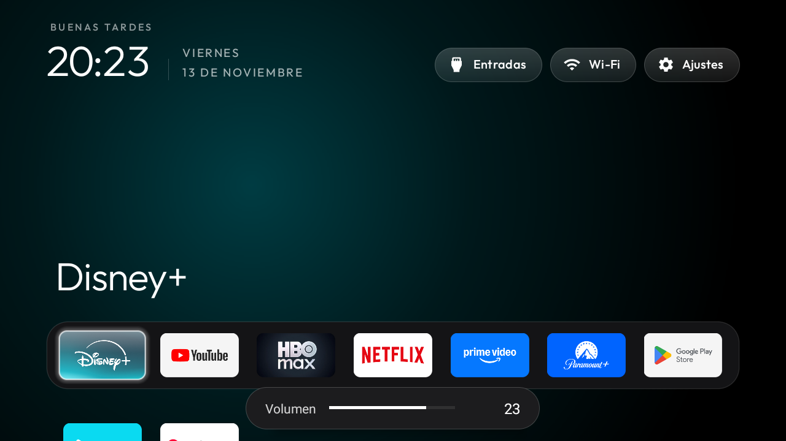
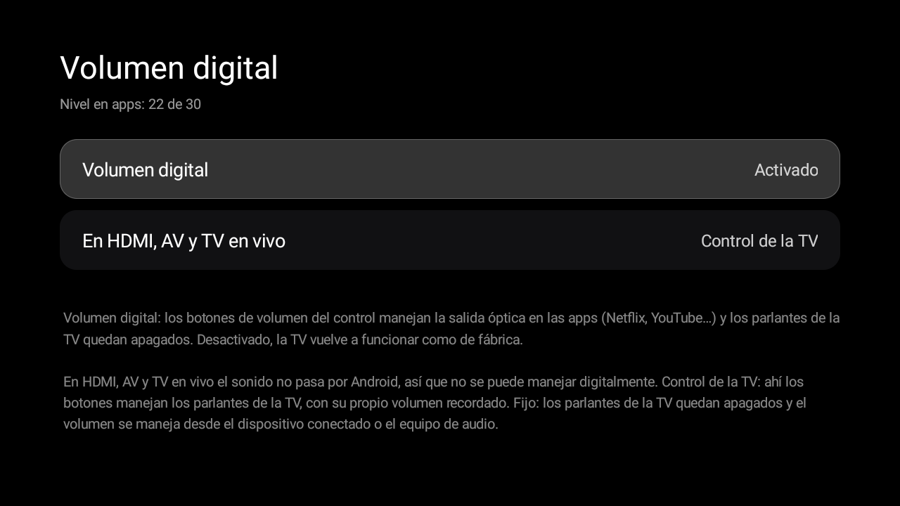

# Digital Volume for Android TV

Lets the remote's volume keys control the **optical (S/PDIF) output** on Android TVs whose firmware sends it at a
fixed level, the way a Chromecast scales its own output. The TV speakers stay silent.

| Volume bar | Settings |
|---|---|
|  |  |

## The problem

On some MediaTek Android TVs (found on a Noblex/Skyworth set, codename `shinjuku`, Android TV 11) the optical output
always plays at full level:

- The volume keys only move Android's media volume, and the audio HAL applies it to the TV speakers alone. S/PDIF is
  taken before that point.
- "Speakers: External audio system" only sets that volume to 0. The next Vol+ turns the TV speakers back on.
- The volume keys never reach apps or accessibility key filters: the system routes them straight to AudioService.

With speakers or a DAC on the optical output, the only volume control left is the one on the amplifier.

## How it works

- A `DynamicsProcessing` effect on the global output mix (session 0) sets an input gain. The mix is attenuated
  before the HAL splits it to the speakers and S/PDIF, so the optical output follows it.
- The app listens to the system's volume broadcasts, turns each key press into a step of its own level
  (30 steps of 1.5 dB) and puts the media volume straight back to 0, so the TV speakers stay silent.
- Its own volume bar sits over the system one, which no app can turn off.
- Mute toggles the digital level as well.

## What it cannot do

**HDMI, AV and Live TV.** Their audio is a hardware patch (`hdmi-in -> speaker`, no software bridge in
`dumpsys media.audio_flinger`): it never passes through Android's mix, so no app can change its level. The settings
screen lets you pick what the keys do there:

- **TV control** (default): the keys drive the TV speakers with the factory volume bar, and that volume is
  remembered separately from the apps' level.
- **Fixed**: the TV speakers stay off; control the volume on the connected device or on the amplifier.

**Passthrough audio.** Set the TV's digital output to **PCM**. In Auto or Bypass the TV sends the encoded Dolby
stream and nothing on the TV can change its level.

## When it is useful

- Your TV feeds powered speakers, a DAC or an amplifier through the optical output, and the TV volume does not change
  what you hear there.
- Your amplifier has no ARC/CEC, so the TV remote cannot control it.
- Most of what you watch plays in apps on the TV itself (Netflix, YouTube, Disney+, Max, Prime Video...).

## Tested on

| TV | Chip | Android | Firmware |
|---|---|---|---|
| Noblex NoblexTV (Skyworth, `shinjuku`), Argentina | MediaTek m5621 | Android TV 11 | RTO9.230812.001 |

The key handling relies on how this firmware reports volume changes. Other firmware may report them differently;
`adb logcat -s DigitalVolume` shows what the service sees.

## Install

You need adb access to the TV (Developer options > USB debugging; network debugging on most sets).

```sh
adb connect <tv ip>
./install.sh
```

Then set the TV's digital output to PCM and turn the amplifier up to the loudest level you will want: the TV remote
now goes from silence to that level.

Open **Digital Volume** from the app grid to turn it off (the TV works as it came from the factory) or to choose what
the keys do on HDMI, AV and Live TV.

To remove it: `./install.sh --uninstall`.

## Permissions and privacy

- `MODIFY_AUDIO_SETTINGS`: the gain effect and the media volume reset.
- Accessibility service: only window-change events, to know whether an app or an input is in front and to show the
  volume bar over the system one. It does not read screen content or filter keys.
- No internet permission. Nothing leaves the TV.

## License

MIT
